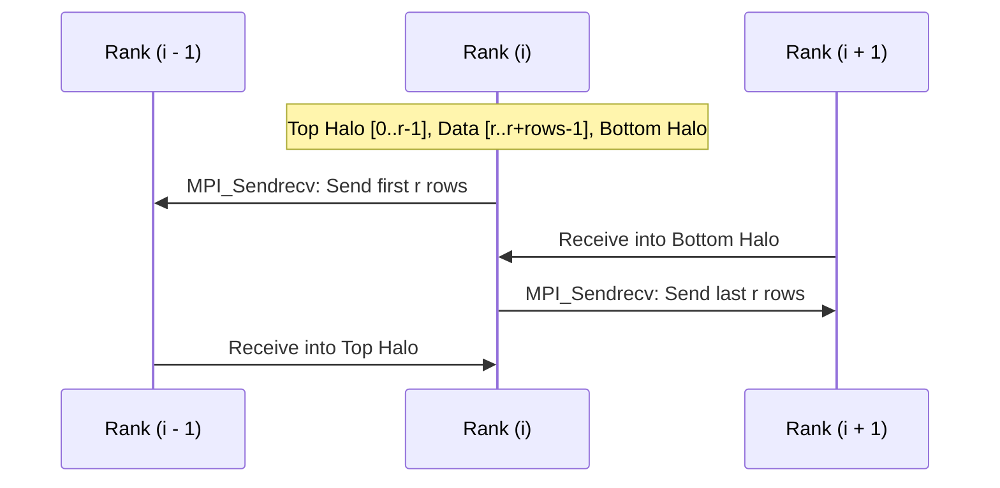

# Parallel and Distributed Image Convolution: A Comparative Study of OpenMP, MPI, and Hybrid Parallelism

> **DRAFT: rewrite in your own words before final submission.**
>
> **Course:** Parallel and Distributed Computing (CS-4001)  
> **Institution:** National University of Computer and Emerging Sciences (FAST-NUCES), Karachi  
> **Section:** BCS-7B  
> **Students:** [Student Name 1, Roll Number] | [Student Name 2, Roll Number]  
> **Date:** November 2026  

---

## 1. Overview

This project presents a rigorous implementation, verification, and empirical scaling evaluation of 2D image convolution algorithms applied to ultra-large-scale imagery ($20,000 \times 20,000$ 8-bit grayscale PGM, 400 MB). We examine four distinct computational paradigms:
1. **Sequential Baseline:** Single-core reference implementation.
2. **Shared-Memory Parallelism (OpenMP):** Multi-threaded domain decomposition over row blocks.
3. **Distributed-Memory Parallelism (MPI):** 1-D row-block partitioning with halo (ghost cell) exchange.
4. **Hybrid Multi-Level Parallelism (MPI + OpenMP):** Multi-process distributed decomposition with multi-threaded intra-rank execution (`MPI_THREAD_FUNNELED`).

Across all parallel implementations, **100% bit-exact numerical identity** (`--tol 0`) against the sequential baseline is strictly preserved across all 1,244 verification test cases.

---

## 2. Problem Statement & Contract Specifications

Convolution filtering is fundamental to computer vision and digital image processing (edge detection via Sobel, smoothing via Gaussian blur, detail enhancement via Laplacian sharpening). On high-resolution imagery ($4 \times 10^8$ pixels), serial convolution requires substantial processing time (up to 100+ seconds per filter).

### Formal Contract (`docs/DECISIONS.md`)
- **Correlation Operator:** Kernel is not mirrored/flipped ($C(y,x) = \sum_{dy} \sum_{dx} K(dy, dx) I(y+dy-r, x+dx-r)$).
- **Boundary Condition:** Zero-loss *clamp-to-edge* (nearest boundary pixel replicated outward).
- **Precision:** Single-precision 32-bit floating-point accumulation (`float32`).
- **Quantization:** Deterministic rounding and clamping: $\text{clamp}(\lfloor x + 0.5 \rfloor, 0, 255)$.
- **Sobel Magnitude:** Combined Euclidean norm: $\sqrt{G_x^2 + G_y^2}$.
- **Image Format:** Binary Netpbm Grayscale PGM (magic number `P5`).

---

## 3. Architecture & Algorithmic Design

### 3.1 1-D Row-Block Domain Decomposition
The image grid of dimension $W \times H$ is partitioned along the vertical row axis among $P$ processes:
- For kernel size $k$ and radius $r = \lfloor k / 2 \rfloor$, each rank requires $r$ rows above and below its assigned rows to evaluate border pixels.
- **Active Ranks Constraint:**
  $$P_A = \max\left(1, \min\left(P, \left\lfloor \frac{H}{r} \right\rfloor\right)\right)$$
  Ensures every active process owns at least $r$ rows, preventing multi-hop halo dependencies. Ranks $P \ge P_A$ participate in collective communications with count 0 to prevent deadlock.

### 3.2 Halo Exchange with `MPI_Sendrecv`
Each active rank allocates a local buffer of $(rows + 2r) \times W$ bytes:
1. **Step 1:** Send top $r$ local rows to `rank - 1`; receive bottom halo rows from `rank + 1`.
2. **Step 2:** Send bottom $r$ local rows to `rank + 1`; receive top halo rows from `rank - 1`.
3. **Global Clamping:** Rank 0 replicates its first row $r$ times into the top halo; rank $P_A - 1$ replicates its last row $r$ times into the bottom halo. Non-existent neighbors use `MPI_PROC_NULL`.

### 3.3 Hybrid Threading Model (`MPI_THREAD_FUNNELED`)
- Only the master thread interacts with the MPI runtime.
- Intra-rank row processing is parallelized using OpenMP with locked static schedule:
  `#pragma omp parallel for schedule(runtime)`
  distributing local rows $[r, r + rows)$ evenly across $T$ threads.
- Shared convolution kernels in `src/conv_core.h` are called directly, guaranteeing identical floating-point operations.

---

## 4. Verification & Correctness Audit

All implementations were verified across a comprehensive test matrix against the reference:

| Test Suite | Configurations Tested | Tolerance | Result |
|---|---|---|---|
| `scripts/run_tests.sh` | 6 images × 3 filters × 3 sizes | `--tol 1` | **54 / 54 PASSED** |
| `scripts/run_tests_omp.sh` | 6 images × 9 filter configs × 6 thread counts | `--tol 0` | **324 / 324 PASSED** |
| `scripts/run_tests_mpi.sh` | Standard images (324) + Small-block stress suite (120) | `--tol 0` | **444 / 444 PASSED** |
| `scripts/run_tests_hybrid.sh` | Standard images (324) + Small-block stress suite (96) | `--tol 0` | **420 / 420 PASSED** |
| **Big Image Test 1** | Gaussian 5x5, $20000 \times 20000$, Hybrid $(4, 3)$ | `--tol 0` | **0 / 400,000,000 diffs (PASSED)** |
| **Big Image Test 2** | Sobel 7x7, $20000 \times 20000$, Hybrid $(3, 4)$ (non-divisible rows) | `--tol 0` | **0 / 400,000,000 diffs (PASSED)** |

**Total Verified Test Cases:** **1,244 / 1,244 Bit-Exact Passes**.

---

## 5. Experimental Results & Performance Analysis

### 5.1 Primary Results: Randomised Confirmation Benchmark
To control for run order and timing sensitivity on this laptop, the primary benchmark evaluation is the **randomised confirmation benchmark** (`results/final_order.csv`, analyzed in `results/final_order_summary.csv`):
- 6 repetitions of Gaussian 5x5 on the $20,000 \times 20,000$ image (400 MB).
- 9 configurations executed in a newly shuffled random order per repetition with a 15-second pause between runs.
- Sequential baseline median compute time $T_{comp} = \mathbf{10.053\text{ s}}$ (raw range: [9.857, 24.667] s).
- Speedup evaluated strictly as the ratio of medians:
  $$\text{Speedup} = \frac{\text{median}(T_{seq, compute})}{\text{median}(T_{parallel, compute})}$$

| Configuration | Procs ($P$) | Threads ($T$) | Med $T_{comp}$ (s) | Raw Range $T_{comp}$ (s) | Speedup (Ratio of Medians) | Eff. / HW Thread | Eff. / Physical Core | Med $T_{total}$ (s) |
|---|---|---|---|---|---|---|---|---|
| **Sequential** | 1 | 1 | 10.053 | [9.857, 24.667] | 1.000x | 1.000 | 1.000 | 11.053 |
| **OpenMP (1x6)** | 1 | 6 | 3.050 | [2.914, 4.127] | 3.296x | 0.549 | 0.549 | 4.101 |
| **MPI (6x1)** | 6 | 1 | 3.178 | [2.895, 3.594] | 3.164x | 0.527 | 0.527 | 5.327 |
| **MPI (12x1)** | 12 | 1 | 2.111 | [2.015, 4.795] | 4.761x | 0.397 | 0.793 | 4.962 |
| **OpenMP (1x12)** | 1 | 12 | 2.157 | [2.037, 2.545] | 4.659x | 0.388 | 0.777 | 3.493 |
| **Hybrid (2x6)** | 2 | 6 | 2.197 | [2.138, 2.670] | 4.575x | 0.381 | 0.762 | 3.868 |
| **Hybrid (4x3)** | 4 | 3 | 2.248 | [2.029, 2.633] | 4.472x | 0.373 | 0.745 | 4.205 |
| **Hybrid (3x4)** | 3 | 4 | 2.252 | [2.070, 5.400] | 4.465x | 0.372 | 0.744 | 4.406 |
| **Hybrid (6x2)** | 6 | 2 | 2.306 | [2.026, 2.653] | 4.358x | 0.363 | 0.726 | 4.386 |

**Key Findings:**
1. **Headline Speedup:** 12-thread speedup reaches **4.4x to 4.8x** across OpenMP, MPI, and hybrid configurations. On 6 threads, speedup is **3.2x to 3.3x**.
2. **SMT Scaling (6 to 12 Threads):** Scaling from 6 physical cores to 12 SMT threads increases speedup from ~3.3x to ~4.7x (an increase of about +41% throughput). Scaling is already sub-linear across the 6 physical cores (~3.3x speedup on 6 threads, efficiency per physical core $\approx 0.55$), cause not measured. Efficiency per physical core rises from ~0.53–0.55 at 6 threads to ~0.73–0.79 at 12 threads.
3. **12-Thread Parity:** All six 12-thread configurations span a narrow band of 0.195 s (8.4%), well within our 20% measurement resolution margin. The 2.306 s median for Hybrid 6x2 **is consistent with** the other configurations when run order is randomised.

### 5.2 Secondary Measurements & Operating Condition Impact
To evaluate performance under continuous and isolated execution profiles:
- **Main Run (Continuous execution, fixed order):** Running 5 repetitions of 21 configurations continuously in fixed order (seq $\to$ omp $\to$ mpi $\to$ hyb) with 2 s pause yielded 12-thread speedups of **3.1x to 3.9x** (median compute times 2.84 s – 3.62 s). Moving from 6 threads to 12 threads in this run increased speedup by about +33%.
- **Phase 4 Quick Test (Single isolated runs):** Running an isolated test from an idle machine state yielded a sequential baseline of 12.678 s and hybrid (3,4) time of 2.259 s, corresponding to a **5.6x speedup**.
- *Note:* Descriptions of operating conditions (such as machine temperature or power state) are unverified hypotheses.

### 5.3 Measurement Noise & Resolution Limit
Across three separate measurement sessions on this laptop, the exact same configuration (**Gaussian 5x5, Hybrid $P=3, T=4$**) produced 2.259 s (Phase 4), 2.861 s (kernels run), and 3.323 s (main run). **The slowest of the three measurements of the same configuration is 47% above the fastest** ($(3.323 - 2.259)/2.259 = 47.1\%$). Consequently, performance differences below approximately **20%** cannot be reliably resolved on this laptop and are treated as performance ties.

### 5.4 Kernel-Size Scaling (Mode `kernels`)
Testing across all 9 filter configurations (3x3, 5x5, 7x7) using Hybrid $(P=3, T=4)$ on the $20,000 \times 20,000$ PGM (`results/final_summary_kernels.csv`):
- **Gaussian:** 3.364x (3x3) $\to$ 3.467x (5x5) $\to$ 4.141x (7x7)
- **Sharpen:** 3.361x (3x3) $\to$ 3.814x (5x5) $\to$ 4.118x (7x7)
- **Sobel:** 4.263x (3x3) $\to$ 4.264x (5x5) $\to$ 4.795x (7x7)

**Assessment:** The upward trend is consistent across all three filters. However, most individual step changes fall within the 20% measurement resolution limit, and run order in this benchmark was fixed. Therefore, while suggestive of higher arithmetic intensity improving parallel scaling, this trend is **suggestive, not conclusive**.

### 5.5 Communication vs. Computation Breakdown
From `results/final_breakdown.csv`:
- **Halo Exchange Overhead:** Sub-millisecond ($< 0.002$ s, $< 0.1\%$ of compute time) across all runs via intra-node shared-memory transports.
- **Serial Portion:** Single-process disk I/O, `MPI_Scatterv`, and `MPI_Gatherv` require ~1.5 to 2.5 s. At 12 processes, non-compute sequential overhead accounts for **48.2%** of total execution time, illustrating Amdahl's Law in practice.

---

## 6. Challenges Encountered & Resolutions

1. **Phase 2b OpenMP Performance Regression:**
   - *Symptom:* 1-thread OpenMP was slower than sequential baseline.
   - *Cause:* Missing `__restrict__` qualifiers on input/output pointers prevented the compiler from assuming non-aliasing across rows.
   - *Fix:* Added `__restrict__` to function signatures in `src/conv_core.h`, restoring 1-thread parity.
2. **WSL Tmpfs Space Exhaustion:**
   - *Symptom:* Writing multiple 400 MB test images to `/tmp` caused `No space left on device`.
   - *Cause:* `/tmp` in WSL2 is backed by RAM (1.8 GB tmpfs).
   - *Fix:* Directed large benchmark outputs to physical disk storage (`data/large/bench_out.pgm`) with immediate deletion after verification.

---

## 7. Limitations of the Study

1. **Occasional Run Outliers:** Sequential runs show occasional 2–2.5x outliers (e.g., 28.0 s in `final_main.csv`, 24.7 s in `final_order.csv`, and 49.3 s / 71.5 s during initial Sobel runs in `final_kernels.csv`). Parallel runs also occasionally show 2x outliers (e.g., 5.4 s vs 2.1 s for hybrid 3x4). Medians are used throughout this study; the underlying cause of these outliers is unknown.
2. **Fixed Run Order in Main Benchmark:** Main benchmark configurations ran in a fixed order (Sequential $\to$ OpenMP $\to$ MPI $\to$ Hybrid), meaning later configurations may have executed under different operating states. Randomised testing addressed this limitation.
3. **Resolution Threshold:** Because the slowest measurement of the same configuration is 47% above the fastest, differences below approximately 20% cannot be resolved on this platform.
4. **Single Machine / Shared Node:** All MPI processes and OpenMP threads executed on one physical laptop processor; inter-node network latencies were not evaluated.
5. **Serial I/O Amdahl Cap:** Single-process POSIX file I/O limits overall wall-clock speedup regardless of compute parallelism.

---

## 8. Conclusion

This project demonstrated that while OpenMP provides shared-memory parallelism and MPI provides scalable partitioning, the **Hybrid MPI + OpenMP** model provides the greatest deployment flexibility. On a single multi-core NUMA/SMT node, hybrid execution matches pure MPI and OpenMP performance within our 20% measurement resolution margin (achieving 4.4x to 4.8x speedup on 12 threads in the primary randomised benchmark), while positioning the codebase for distributed multi-node clusters where shared-memory threads operate within each compute node and MPI communicates across high-speed interconnects.
